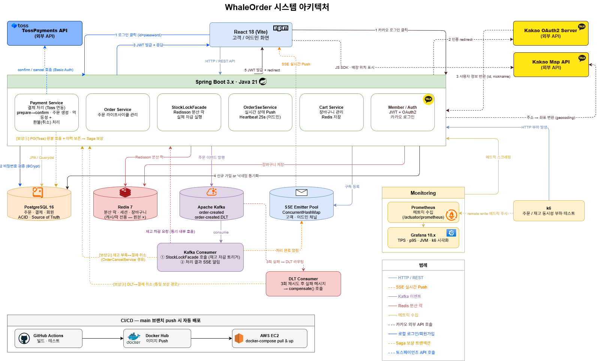

# 시스템 구성도

> WhaleOrder 백엔드 전체 구성과 컴포넌트별 책임



## 컴포넌트

| 계층 | 기술 | 역할 |
|------|------|------|
| API | Spring Boot 3 / Java 21 | REST · SSE 엔드포인트 |
| RDBMS | PostgreSQL | 주문 · 결제 · 회원 등 정합성 데이터 |
| Cache / Lock | Redis + Redisson | 장바구니, 리프레시 토큰, 대기열, 분산 락, 메뉴 캐시 |
| Messaging | Kafka | 주문 처리 비동기화, DLT 기반 보상 트리거 |
| Monitoring | Prometheus + Grafana + Micrometer | 메트릭 수집/시각화 |
| 부하 테스트 | k6 | 일반 부하 + 동시성 검증 |
| 결제 PG | TossPayments 결제위젯 v2 (외부 API) | prepare→confirm 승인/취소 실연동 |

## 주요 흐름 — 결제(선결제, Toss 연동)

```
[Client]
   │ ① POST /api/payments/prepare   (표시 금액 확인)
   ▼
[PaymentService.prepare()]  @Transactional
   │ ② 장바구니 + 매장 OPEN + 메뉴 isOnSale + Stock 검증
   │ ③ SHA-256 멱등성 키 (중복 요청 방어)
   │ ④ Orders(AWAITING_PAYMENT) + Payment(PENDING) 저장
   │ ⑤ { tossOrderId, amount } 반환
   ▼
━ 프런트: 토스 결제위젯(widgets.requestPayment) 오픈 → 사용자 결제 ━
━ 토스가 successUrl로 리다이렉트 (paymentKey·orderId·amount) ━
   │
   ▼ ⑥ POST /api/payments/confirm
[PaymentService.confirm()]  @Transactional(noRollbackFor=PaymentFailedException)
   │ ⑦ confirm 전용 멱등성 락 + 표시 금액 재검증
   │ ⑧ TossPaymentClient.confirm() → 토스 실제 승인 API 호출 (Basic Auth)
   │ ⑨ 성공: order AWAITING_PAYMENT→PENDING + Payment SUCCESS + OrderCreatedEvent publish
   │ ⑩ 실패(토스 4xx/5xx): Payment FAILED + order.cancelUnpaid() + PaymentFailedException
   ▼
━ TX commit ━
   │
[OrderEventListener]  @TransactionalEventListener(AFTER_COMMIT)
   │ ⑪ Kafka publish (order-created) + 장바구니 비우기
   ▼
[Kafka: order-created]
   │ ⑫ Consumer 처리
   ▼
[OrderProcessingService]
   │ ⑬ 재고 차감 (StockLockFacade — 분산락) + SSE 푸시
   │ ⑭ 차감 실패 시 부분 복구 + OrderCancelService.cancelOrder() (Toss 환불 호출 포함)
   │ ⑮ 3회 재시도 실패 시 DLT → compensate() → 주문/결제 동시 취소 (Toss 환불 포함)
```

결제창을 열어놓고 탭을 닫는 등 `confirm`까지 못 간 주문은 `PaymentSweepScheduler`가 5분마다 스캔해 30분 이상 `AWAITING_PAYMENT`인 건을 정리한다.

## 관련 문서

- [Payment 도메인](../domains/payment.md) — prepare/confirm 상세 흐름, 토스 orderId 변환, 환불 정책
- [동시성 제어](concurrency-control.md)
- [실시간 푸시](realtime-sse.md)
- [Saga 보상 트랜잭션](saga-compensation.md)
- [Kafka 이벤트 스트림](kafka-event-stream.md)
- [Redis 활용처](redis-usage.md)
